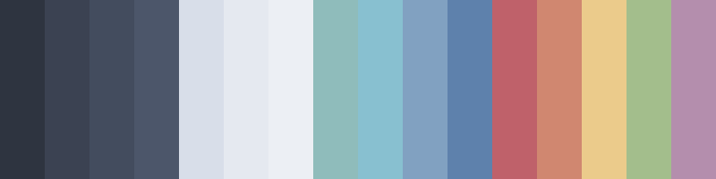

# Markdown Test

This is a test file for Markdown conversions. Add every construct that shows up 
in ordinary technical docs. The first paragraph contains tests for **bold**, 
*italic*, ***both***, ~~strikethrough~~, `inline code`, and a 
[link to the Nord palette](https://www.nordtheme.com/docs/colors-and-palettes).

## Headings

This is body text to confirm spacing above and below.

It also contains a second line.

### Third level

This is body text to confirm spacing above and below.

#### Fourth level

This is body text to confirm spacing above and below.

##### Fifth level

This is body text to confirm spacing above and below.

###### Sixth level

This is body text to confirm spacing above and below.

## Lists

### Bullet Lists

- A top-level bullet
- Another top-level bullet with sublist:
  - Nested item one
  - Nested item two, which wraps to a second line to check if hanging indents
    are properly displayed and converted.
    - Third level, because someone always does it
- Back at the top level

### Ordered Lists

1. Ordered lists
2. Count correctly
   1. Even when nested
   2. And restart per level
3. And resume after a nested block

### Loose Lists

- First loose item.

  With a second paragraph inside it.

- Second loose item.

## Blockquotes

> A blockquote. Set back from the body with a bar on the left. It reads as a 
> quote. The bar is frost-colored. Make sure there's no awkward gap at the 
> bottom.
>
> A second paragraph inside the same quote.

## Tables

| Column | Type   | Default | Notes                                    |
|:-------|:-------|:--------|:-----------------------------------------|
| id     | int    |         | Primary key                              |
| name   | text   | `''`    | Display name, may be empty               |
| score  | float  | `0.0`   | Normalized to the range zero through one |
| tags   | text[] | `{}`    | Free-form, lowercased on write           |

| Left | Center | Right |
|:-----|:------:|------:|
| a    |   b    |     c |
| aa   |   bb   |    cc |

## Images



## Code

Inline code like `git rebase -i HEAD~3` should have a raised background and 
mono-type with no visible shift.

A fenced block:

```bash
#!/bin/bash
# 
# nord-bars.sh
#
# Generates nord-bars.png: the 16 Nord palette colors as 50x200 vertical bars.

set -euo pipefail

colors=(
  2E3440 3B4252 434C5E 4C566A         # Polar Night
  D8DEE9 E5E9F0 ECEFF4                # Snow Storm
  8FBCBB 88C0D0 81A1C1 5E81AC         # Frost
  BF616A D08770 EBCB8B A3BE8C B48EAD  # Aurora
)

args=()
for c in "${colors[@]}"; do
  args+=("xc:#$c")
done

magick -size 50x200 "${args[@]}" +append "${1:-nord-bars.png}"
```

A block with no language:

```
plain text block
  preserve  extra  spacing
and   tabs,   which   are   here.